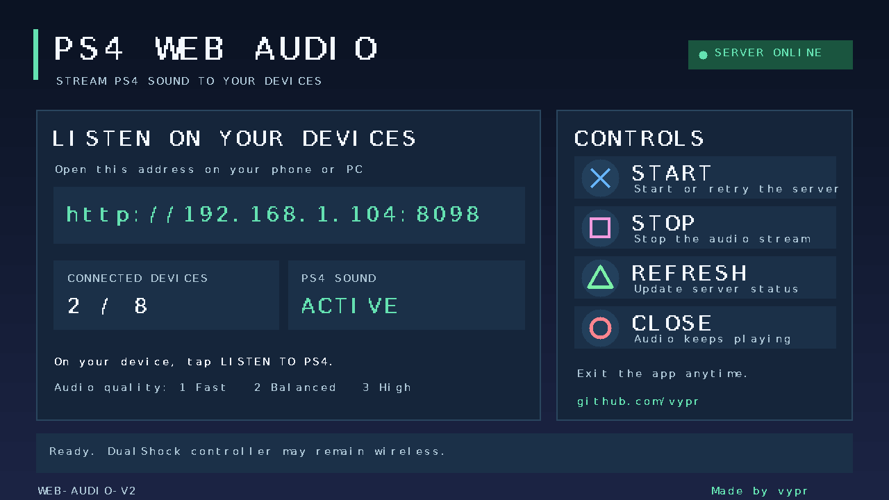

# PS4 Web Audio

**Stream PS4 game audio to a web browser over your local network.** Listen on a PC, phone, or tablet using its speakers or Bluetooth headphones—without pairing your headphones directly to the PS4.



> This image is a UI preview. The installed app runs on the PS4.

## Features

- **PS4 home-screen app** with simple controller controls and server status.
- **Browser audio player** at `http://<PS4-IP>:8098/`—no companion application required.
- **Up to 8 simultaneous listeners**, each with an independent audio-quality setting.
- **Three audio modes**, from lower latency to maximum source precision.
- **Automatic iPhone/iPad, Android, and desktop detection**, with a manual override.
- **Disconnect handling** so one listener leaving should not interrupt the others.
- **Network test tone**, browser volume control, and playback diagnostics.
- **No Background edition:** the experimental background/WAV player is not included.

## Audio modes

| Mode | Stream format | Best for |
| --- | --- | --- |
| **1 — Fastest** | 24 kHz mono, 16-bit PCM | Lower bandwidth and latency |
| **2 — Balanced** | 48 kHz stereo, 16-bit PCM | Recommended for most devices |
| **3 — Highest Quality** | 48 kHz stereo, 32-bit float | Maximum source precision |

Each device selects its own mode. Higher-quality modes use more bandwidth and may require a larger playback buffer. Actual latency depends on the network, browser, and output device.

## Requirements

- A PS4 running **GoldHEN**. Tested on **firmware 14.00**; other firmware versions are expected to work but have not yet been verified.
- The PS4 and listening devices connected to the **same local network**.
- GoldHEN **Payload Server (port 9090)** enabled when launching the bundled streaming payload.
- A modern web browser on the listening device.

## Install the PKG

1. Download **`PS4-Web-Audio.pkg`** from the GitHub release assets.
2. Transfer the PKG to an exFAT USB drive or to the PS4's `/data/pkg/` directory using FTP.
3. Install the package with GoldHEN's package installer.
4. Launch **PS4 Web Audio** from the PS4 home screen.
5. If necessary, enable GoldHEN Payload Server on port **9090** and press **✕ Start** to retry starting the audio server.

The installed PKG includes the streaming payload. You do **not** need to install a separate `.bin` to use the app.

## Listen from your PC or phone

1. Launch the PS4 Web Audio app and confirm the server is online.
2. On your PC, phone, or tablet, open:

   ```text
   http://<PS4-IP>:8098/
   ```

   For example, if your PS4 IP address is `192.168.1.104`, visit `http://192.168.1.104:8098/`.
3. Select **Fastest**, **Balanced**, or **Highest Quality**.
4. Press **Listen to PS4**.
5. Adjust the volume or change audio quality directly on that device.

Other listeners can connect to the same address and choose different settings independently.

## PS4 controls

| Controller button | Action |
| --- | --- |
| **✕ Cross** | Start / retry the audio server |
| **□ Square** | Stop the audio server |
| **△ Triangle** | Refresh status |
| **○ Circle** | Close the app; leave the server running |

The app attempts to start its bundled server when launched if one is not already running.

## Build from source

The repository contains the native PS4 interface, Web Audio V2 No Background source, and the PKG build script. A **complete OpenOrbis PS4Toolchain SDK** is required to build the installable package.

Install common WSL/Ubuntu prerequisites:

```bash
sudo apt update
sudo apt install -y clang lld llvm build-essential python3 python3-pil curl unzip tar libicu-dev
```

Install the full Linux SDK from [OpenOrbis PS4Toolchain releases](https://github.com/OpenOrbis/OpenOrbis-PS4-Toolchain/releases), then set the environment variable to the folder containing `link.x`:

```bash
export OO_PS4_TOOLCHAIN="$HOME/openorbis-setup/sdk/OpenOrbis/PS4Toolchain"
```

From the project directory:

```bash
bash test_project.sh
bash build_pkg.sh
```

A successful build produces **`PS4-Web-Audio-No-BG.pkg`** in the project directory. Depending on your Ubuntu version, the OpenOrbis package utility may also require a compatible .NET/OpenSSL runtime. Verify that package creation and validation succeed before installing the result.

## Project structure

```text
native/                     PS4 home-screen interface and controls
WebAudioV2_NoBG_source/     Streaming server and browser player source
assets/                     App icon and bundled streaming payload
build_pkg.sh                OpenOrbis PKG build script
test_project.sh             Local project checks
UI_PREVIEW.png              Interface preview
```

## Troubleshooting

- **Page won't open:** Check that the PS4 server shows Online, confirm both devices are on the same LAN, and verify the PS4 IP address.
- **Server won't start:** Enable GoldHEN Payload Server (9090), then use **✕ Start** again.
- **No sound:** Press **Listen to PS4**, verify the listening device's output/volume, and try **Balanced** quality or the **Network test tone**.
- **Multiple audio servers:** Stop the older standalone payload before starting the PKG's bundled server; both use port **8098**.

## Donations

Donations are optional and help support future development of PS4 Web Audio.

| Cryptocurrency | Network | Wallet address |
| --- | --- | --- |
| **Bitcoin (BTC)** | Bitcoin (BTC) | `16hghGSssvfd18ggW4ZvpKuzxgpaQY2w3u` |
| **Tether (USDT)** | TRON (TRC20) | `TLq7Vfuos49WEUSBiKeYEKwhBBdmrJRpqZ` |
| **Ethereum (ETH)** | Ethereum mainnet | `0x6fdd52a2b6105af212e77e5ed5b5dd8733e02a0b` |
| **Litecoin (LTC)** | Litecoin | `LYpn7yZyhBLTfpS8YAje5dwCun2xpU63nE` |

**Important:** Use the exact network shown for each currency. Transfers made on an incompatible network may be permanently lost. If you're donating from an exchange, check its minimum withdrawal/deposit requirements first.

Thank you for supporting the project!

## Network and compatibility notes

Audio is served over **unencrypted HTTP on your local network**, without authentication. **Do not expose or port-forward port 8098 to the internet.**

**Firmware compatibility:** Tested on **PS4 firmware 14.00** with GoldHEN. It may also work on other firmware versions, but those versions have not yet been tested or confirmed.

## Credits & Copyright

- Portions are adapted from [PS4 Bluetooth Audio](https://github.com/XB-01/ps4-bt-audio), © 2026 XB-01, under the MIT License. The original copyright and license notice are preserved in [LICENSE](LICENSE).
- Built with [OpenOrbis](https://github.com/OpenOrbis/OpenOrbis-PS4-Toolchain). Bundled SDK components and font assets retain their respective licenses.
- © 2026 PS4 Web Audio contributors for project-specific modifications.
